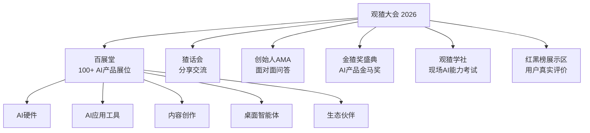

# 第二届观猹大会 2026 参展项目全览

> 调研日期：2026年10月27日
> 大会主题：**"见证创造发生"**
> 数据来源：官方网站、新闻报道、社区用户分享

---

## ⚠️ 关于"展厅"命名的重要说明

经过多轮全网搜索确认，**观猹大会并未采用 A/B/C/D/E 字母编号的展厅命名方式**。大会举办地点位于杭州茶叶博览会会议会展中心三号展馆，内部以**主题板块**划分展区，而非传统的字母编号展厅。

因此，本报告将按照观猹大会实际的展区体系进行整理，主要分为：
- **百展堂**（主展区，100+ AI 产品展位）
- **猹工坊**（AI 互动游戏区，G01-G18 展位）
- **灵感制作所**（AI 创作类产品区）
- **生态合作伙伴区**（大厂与战略合作伙伴展区）
- **表演/路演区**（主舞台、路演决赛等）

---

## 一、活动概述

### 1.1 基本信息

| 项目 | 详情 |
|------|------|
| **活动全称** | 第二届观猹大会 2026 |
| **英文名称** | Guancha Conference 2026 |
| **活动性质** | AI 产品社区年度线下盛会，被誉为"AI 界的大众点评" |
| **举办时间** | 2026年10月23日—25日（百展堂开放：10月24日—25日 10:00-18:00） |
| **举办地点** | 杭州市西湖区龙坞茶镇 · 杭州茶叶博览会会议会展中心（三号展馆） |
| **场馆体量** | 9.8万平方米 |
| **展会规模** | 100+ AI 展位、上千名从业者参与 |
| **大会主题** | "见证创造发生" |
| **主办方** | 观猹（杭州似一科技有限公司旗下品牌） |
| **创始人/CEO** | 仲泰（2002年生，杭州电子科技大学毕业） |
| **投资方** | 红杉中国、华兴资本（种子轮，千万级） |

### 1.2 大会六大体验板块

### 1.3 官方渠道

| 平台 | 链接/账号 |
|------|----------|
| **官方网站** | [https://watcha.cn/](https://watcha.cn/) |
| **百展堂报名页** | [https://watcha.cn/activities/dahui2026-expo](https://watcha.cn/activities/dahui2026-expo) |
| **官方公众号** | 观猹insights |
| **官方视频号** | 观猹官方视频号 |
| **微博话题** | #观猹大会2026# #第二届观猹大会# |

---

## 二、展区分布总览

### 2.1 展区体系

| 展区名称 | 位置/说明 | 主要内容 |
|---------|----------|---------|
| **百展堂** | 三号展馆主展区 | 100+个 AI 产品摊位，各类 AI 应用、硬件、工具展示与体验 |
| **猹工坊** | G01-G18 一整排展位 | AI 互动游戏、创意体验项目 |
| **灵感制作所** | 百展堂内主题区域 | AI 创作类产品展示 |
| **生态合作伙伴区** | 百展堂内 | 六大战略合作伙伴展区 |
| **红黑榜展示区** | 入口附近 | 用户真实评价、红黑板点评 |
| **AI 茶饮实验站** | 场馆一角 | 机器冲泡标准化西湖龙井 |
| **观猹商店（S1）** | 入口附近 | 周边商品售卖 |
| **主舞台区** | 会场中心 | 金猹奖盛典、表演、路演 |

### 2.2 参展项目类别分布

本届大会参展项目涵盖以下主要类别：

- **AI 硬件**：桌面 AI 设备、机器人、本地知识库硬件、嵌入式设备等
- **AI 应用与工具**：桌面智能体、效率工具、知识库、编程助手等
- **AI 内容创作**：视频生成、3D 生成、音乐创作、科研可视化等
- **AI 文娱与互动**：AI 艺人、AI 游戏、AI 音乐现场等
- **AI 生态平台**：大模型厂商、办公软件、电商平台等
- **独立开发者 / OPC**：一人公司、小团队的创新项目

---

## 三、各展区参展项目明细

### 3.1 百展堂 · AI 硬件类

| 项目名称 | 开发方/团队 | 类别 | 一句话简介 | 官方链接 | 相关报道 |
|---------|------------|------|-----------|---------|---------|
| **HachimoDock** | 小米技术委创新产品团队 | 开源 AI 硬件 / 桌面 AI 设备 | 可自由改造的桌面 AI 硬件，集成个性化桌宠、语音操控电脑端 Agent、智能家居联动，硬件自制成本约 150 元，已在 GitHub 开源 | [GitHub 开源](https://github.com/)（官方仓库） | [IT之家报道](https://m.ithome.com/html/1017842.htm) · [新浪科技](http://m.toutiao.com/group/7700843663849308698/) |
| **Linkly AI（本地超级知识库）** | Linkly AI 团队（杭州） | AI 硬件 / 知识管理 / 本地搜索 | 手机大小的卡片式硬件，一键导入会议录音生成文字纪要，与本地资料建立连接形成私密知识库，支持 AI Agent 集成 | [官网](https://linkly.ai/zh) | [潮新闻报道](http://m.toutiao.com/group/7700890098960302619/) |
| **"在场"家庭陪伴机器人** | 朱书浛（13 岁独立开发者） | 机器人 / 教育 / 青少年创客 | 13 岁上海女孩用零花钱自制的半成品家庭陪伴机器人，能陪孩子写作业、进行表情互动 | 暂无 | [潮新闻报道](http://m.toutiao.com/group/7700890098960302619/) · [杭州in新闻微博](https://m.weibo.cn/detail/5358310402560092) |
| **启元 Q1 机器人** | 上纬新材 · 启元机器人 | 具身智能 / 消费级机器人 | 全球首个可 DIY 角色的个人机器人，大会开场舞蹈表演 | [启元官网](http://qiyuan.ai/) | [央广网报道](http://tech.cnr.cn/techgd/20261026/t20261026_527853391.shtml) |
| **安克飞书录音豆** | 安克创新 × 飞书 | AI 硬件 / 办公录音 | 金猹奖"年度最佳 AI 硬件产品"获奖产品 | 安克创新官网 | [金猹奖报道](http://tech.cnr.cn/techgd/20261026/t20261026_527853392.shtml) |

### 3.2 百展堂 · AI 应用与工具类

| 项目名称 | 开发方/团队 | 类别 | 一句话简介 | 官方链接 | 相关报道 |
|---------|------------|------|-----------|---------|---------|
| **WorkBuddy** | 腾讯云 CodeBuddy 团队 | AI 桌面智能体 / 办公效率 | AI 原生的桌面智能体工作台，零部署开箱即用，本地优先+隔离沙箱设计，支持多 Agent 并行处理办公任务。金猹奖"年度新锐产品" | [产品页](https://watcha.cn/products/workbuddy) | [央广网报道](http://tech.cnr.cn/techgd/20261026/t20261026_527853392.shtml) |
| **蚂蚁阿福** | 蚂蚁集团 | AI 健康 / 医疗大模型 | AI 健康管家，涵盖健康科普、就诊咨询、报告解读、健康档案等，用户量达 1.5 亿，单日健康咨询量近 2000 万次。金猹奖"年度最佳口碑产品" | 蚂蚁阿福 App | [新华网报道](http://www.xinhuanet.com/tech/20261026/68b68b757ec14b7b92766786e98e8d7a/c.html) |
| **Elys AI（MeWoo）** | Elys AI 团队 | AI 社交 / AI 世界生成 / 多模态 | 一句话生成一个 AI 世界，统一文本、图像、视频、音频、动作、行为 6 种模态，打造可进入、可交互的个人数字空间。金猹奖"年度最佳创意产品" | [官网](https://aielys.com/) · [X/Twitter](https://x.com/MeWooApp) · [小红书](https://xhslink.cn/o/3FPqxvI61Zs) · [微博](https://weibo.com/u/9129988300) | [新华网报道](http://www.xinhuanet.com/tech/20261026/68b68b757ec14b7b92766786e98e8d7a/c.html) |
| **Tripo AI** | Tripo 团队 | AI 3D 生成 / 创作者工具 | AI 3D 生成平台，通过文本、图片或草图快速生成可用 3D 模型，支持纹理、绑定、动画全流程，社区创作者超 650 万。金猹奖"年度最具潜力产品" | [官网](https://tripo3ds.com/) | [金猹奖报道](http://tech.cnr.cn/techgd/20261026/t20261026_527853392.shtml) |
| **天与视界 / Paper2Any** | 天与视界（深圳）科技有限公司（清华背景） | AI 内容创作 / 科研可视化 | 用 AI 把晦涩的科研论文变成可视化的视频和动画，让前沿科学从期刊里"走"出来 | [企业信息](https://shuidi.cn/company-0b37dc3e9b06c007c3b3e378dad36b01.html) | [潮新闻报道](http://m.toutiao.com/group/7700890098960302619/) |
| **ima** | ima 团队 | AI 效率工具 | 金猹奖"年度最佳 AI 效率产品" | [产品页](https://watcha.cn/@28) | [金猹奖报道](http://tech.cnr.cn/techgd/20261026/t20261026_527853392.shtml) |
| **Manus / Cue** | Manus 团队 | 桌面智能体 / AI 助理 | 金猹奖"年度最佳桌面智能体产品"，推出 AI 个人助理 Cue | [产品页](https://watcha.cn/@28) | [金猹奖报道](http://tech.cnr.cn/techgd/20261026/t20261026_527853392.shtml) |
| **绘声绘色 AI** | 独立开发者 | AI 内容创作 / 音乐绘画 | 画画时可以搭配背景音乐的 AI 工具，体验感舒适 | 暂无 | [观猹社区用户分享](https://watcha.cn/@28) |
| **WeSight** | 苍何（个人开发者） | AI 工具 / 观察分析 | 个人开发者苍何的产品，首次参加展会 | 暂无 | [ZAKER新闻](https://www.myzaker.com/article/6adde89b8e9f0901c758e052) |
| **Flova AI** | Flova 团队 | AI 视频创作 Agent | 面向创作者和叙事者的 AI 视频创作 Agent，观猹评分 8.4（67 条猹评） | [产品页](https://watcha.cn/products/flova-ai) | [观猹官网](https://watcha.cn/) |
| **纳逗 Pro** | 爱奇艺光影纪元 | AI 影视制作 | 爱奇艺打造的专业级影视制作 AI 平台 | [产品页](https://watcha.cn/products/na-dou-pro) | [界面新闻](https://www.jiemian.com/article/15239666.html) |
| **MonkeyCode** | 长亭百智云 | AI 编程 / 开发工具 | 输入需求就能开始编程，支持不限额度免费使用，无需本地准备环境 | [产品页](https://watcha.cn/products/monkeycode) | [界面新闻](https://www.jiemian.com/article/15239666.html) |
| **库库 AI 企业版** | 百度 | AI 办公 / 企业效率 | 超级组织 AI 办公平台，观猹评分 7.2 | [产品页](https://watcha.cn/products/kukuaileads) | [观猹官网](https://watcha.cn/) |

### 3.3 猹工坊展区（G01-G18）

猹工坊是观猹大会专门设置的 AI 互动体验区，位于百展堂一侧，展位号以 G 开头。

| 项目名称 | 展位号 | 类别 | 一句话简介 | 官方链接 | 来源 |
|---------|--------|------|-----------|---------|------|
| **Xchannel 假装创业集团** | G15 | AI 游戏 / 社区 / 内容创作 | 由 Stella 娜酱带领的团队，展示 4 款 AI 小游戏：《梗图宇宙》、豆总默契大作战、AI 猹相馆、X.Channel 入职考试 | [官网](https://x.jueyunai.cn/) · [梗图宇宙](http://gengtu.jueyunai.cn/) · [猹相馆](https://xiang.jueyunai.cn) · [入职考试](http://kaoshi.jueyunai.cn/) | [观猹社区](https://watcha.cn/discuss/topics/44) |
| **冷静狗狗嵌入式** | G16 | 嵌入式 / AI 硬件 | G16 展位嵌入式开发项目 | 暂无 | [观猹社区](https://watcha.cn/discuss/topics/44) |
| **砾石进化** | G14 | AI / 科技 | G14 展位参展项目 | 暂无 | [观猹社区](https://watcha.cn/discuss/topics/44) |

### 3.4 灵感制作所展区

| 项目名称 | 开发方 | 类别 | 一句话简介 | 官方链接 | 来源 |
|---------|--------|------|-----------|---------|------|
| **Beav** | Jamba 老师 | AI 工具 / 效率 | 一款由 Jamba 开发的 AI 产品，迭代更新速度快、响应迅速 | [产品页](https://watcha.cn/products/beav) | [观猹社区](https://watcha.cn/discuss/topics/44) |

### 3.5 生态合作伙伴区

以下六大合作伙伴获颁首届金猹奖"年度 AI 生态推动奖"，均在大会现场设有展区：

| 项目/公司 | 类别 | 一句话简介 | 官方链接 | 来源 |
|----------|------|-----------|---------|------|
| **商汤小浣熊（Raccoon）** | AI 办公 / 数据分析 | 商汤科技出品的产业级 AI 智能体助手，将 AI 大模型与文档编辑、数据分析结合 | [商汤官网](https://www.sensetime.com/cn/product-detail?categoryId=51134390) | [界面新闻](https://www.jiemian.com/article/15239666.html) |
| **联想天禧 AI** | AI 智能体 / 生态 | 联想旗下 AI 智能体平台，现场展示超能模式 | [微博](https://m.weibo.cn/detail/5357615325647213) | [界面新闻](https://www.jiemian.com/article/15239666.html) |
| **MiniMax** | 大模型 / AI 生态 | 国内头部大模型公司，AI 生态合作伙伴 | [MiniMax 官网](https://www.minimaxi.com/) | [央广网](http://tech.cnr.cn/techgd/20261026/t20261026_527853391.shtml) |
| **WPS Office** | AI 办公 | 金山办公旗下 AI 办公软件 | [WPS 官网](https://www.wps.cn/) | [央广网](http://tech.cnr.cn/techgd/20261026/t20261026_527853391.shtml) · [获奖报道](http://m.toutiao.com/group/7700963379305562659/) |
| **闲鱼** | AI 电商 | 阿里巴巴旗下二手交易平台，AI 生态合作伙伴 | [闲鱼官网](https://www.goofish.com/) | [央广网](http://tech.cnr.cn/techgd/20261026/t20261026_527853391.shtml) |
| **京东数字人 JoyAvatar** | AI 数字人 / 电商 | 京东旗下数字人产品，AI 生态合作伙伴 | 京东官网 | [央广网](http://tech.cnr.cn/techgd/20261026/t20261026_527853391.shtml) |

### 3.6 表演与路演项目

#### 主舞台表演

| 项目 | 类别 | 简介 | 来源 |
|------|------|------|------|
| **芒果TV《了不起啊朋友》AI 艺人** | AI 艺人 / 文娱 | 五位 AI 艺人——程渡、方屿、林恩娜、戚许、展颜，带来剧集主题曲《你的名字》首演 | [央广网](http://tech.cnr.cn/techgd/20261026/t20261026_527853391.shtml) |
| **Yuri 尤栗 AI 音乐现场** | AI 音乐 | 超现实 AI 音乐现场表演 | [界面新闻](https://www.jiemian.com/article/15239666.html) |
| **启元 Q1 机器人舞蹈** | 具身智能 / 表演 | 开场舞蹈表演的具身智能机器人 | [央广网](http://tech.cnr.cn/techgd/20261026/t20261026_527853391.shtml) |

#### 亚马逊云科技 AI Native 创业复兴总决赛 Top 5

| 项目名称 | 类别 | 一句话简介 | 来源 |
|---------|------|-----------|------|
| **Meowster** | AI 陪伴 / 宠物 | 一只 AI 猫，有性格、有作息、有长期记忆，断网也能互动，首站日本市场 | [ZAKER新闻](https://www.myzaker.com/article/6adde89b8e9f0901c758e052) |
| **MysticX** | AI 灵性 / 娱乐 | 塔罗、人类图、灵魂伴侣画像、成长日记等多模态 AI 应用，运营三个月近 30 万用户 | [ZAKER新闻](https://www.myzaker.com/article/6adde89b8e9f0901c758e052) |
| **Otterlantis** | AI 教育 / 创作 | 给孩子做的 AI 版乐高，一句话生成可玩的 3D 世界，还能 3D 打印，计划欧美首发 | [ZAKER新闻](https://www.myzaker.com/article/6adde89b8e9f0901c758e052) |
| **创思 AI 安全** | AI 安全 / 评测 | 给 Agent 做安全评测与对齐 | [ZAKER新闻](https://www.myzaker.com/article/6adde89b8e9f0901c758e052) |
| **Seeknetic** | 企业数据 / AI | 帮企业把数据变得能理解、能调用 | [ZAKER新闻](https://www.myzaker.com/article/6adde89b8e9f0901c758e052) |

---

## 四、首届金猹奖获奖名单

首届"金猹奖"被誉为"AI 产品金马奖"，于 10 月 24 日晚在观猹大会上颁发。由陈铭主持，设红毯环节。3000 余款 AI 产品进入评选范围，最终 10 余款产品脱颖而出。

### 产品类奖项

| 奖项 | 获奖产品 | 开发方 |
|------|---------|--------|
| **年度最佳口碑产品** | 蚂蚁阿福 | 蚂蚁集团 |
| **年度新锐产品** | WorkBuddy | 腾讯云 |
| **年度最佳创意产品** | Elys AI（MeWoo） | Elys AI |
| **年度最具潜力产品** | Tripo AI | Tripo |
| **年度最佳 AI 效率产品** | ima | ima 团队 |
| **年度最佳桌面智能体产品** | Manus（Cue） | Manus 团队 |
| **年度最佳 AI 硬件产品** | 安克飞书录音豆 | 安克创新 × 飞书 |
| **年度最佳 AI 视频创作产品** | （待补充） | — |
| **年度最佳 AI 音乐创作产品** | （待补充） | — |
| **年度最佳 AI 教育产品** | （待补充） | — |

### 生态类奖项

| 奖项 | 获奖方 |
|------|--------|
| **年度 AI 生态推动奖** | 闲鱼、MiniMax、商汤小浣熊、WPS Office、联想天禧 AI、京东数字人 JoyAvatar |

### 观猹员奖项

共设 3 个观猹员奖项（具体获奖人待补充）。

### OPC 奖项

设 1 个 OPC（一人公司）奖项（具体获奖项目待补充）。

> 来源：[央广网](http://tech.cnr.cn/techgd/20261026/t20261026_527853392.shtml) · [新华网](http://www.xinhuanet.com/tech/20261026/68b68b757ec14b7b92766786e98e8d7a/c.html) · [观猹官网](https://watcha.cn/)

---

## 五、战略合作签约

大会现场举行了**六项战略合作签约**：

| 合作方 | 合作内容 |
|--------|---------|
| **支付宝 AI 付** | 共同推出「爱猹收」，帮助开发者实现产品商业化 |
| **无问芯穹** | 联合推出 TokenDance，支持开发者一站式调用主流模型 |
| **杭州学军中学** | 为学生提供 AI 实践与作品创作机会 |
| **ATOX** | 连接海内外青年创造者 |
| **博客园 + 爱獭** | 共同打造 AI 原生知识社区 ReadmeX |
| **阿里云** | 连接技术工具、实践经验与社区真实需求 |

> 来源：[央广网](http://tech.cnr.cn/techgd/20261026/t20261026_527853391.shtml)

---

## 六、相关报道汇总

### 权威媒体报道

| 媒体 | 标题 | 日期 | 链接 |
|------|------|------|------|
| 新华网 | 3000余款AI产品角逐首届"金猹奖"，WorkBuddy、蚂蚁阿福等摘得年度大奖 | 2026.10.26 | [链接](http://www.xinhuanet.com/tech/20261026/68b68b757ec14b7b92766786e98e8d7a/c.html) |
| 央广网 | 百余AI产品亮相杭州 观猹大会成AI创新与口碑风向标 | 2026.10.26 | [链接](http://tech.cnr.cn/techgd/20261026/t20261026_527853391.shtml) |
| 央广网 | "AI产品金马奖"揭晓 首届金猹奖以真实口碑为AI产品立标杆 | 2026.10.26 | [链接](http://tech.cnr.cn/techgd/20261026/t20261026_527853392.shtml) |
| 光明网 | 3000余款AI产品角逐首届"金猹奖" | 2026.10.26 | [链接](https://wlaq.gmw.cn/2026-10/26/content_39066672.htm) |
| 界面新闻 | 百余AI产品亮相杭州，观猹大会成AI创新与口碑风向标 | 2026.10.26 | [链接](https://www.jiemian.com/article/15239666.html) |
| 潮新闻 | AI界"大众点评"开进龙坞茶园！当"茶"遇上"猹"，看传统茶镇如何"破圈" | 2026.10.26 | [链接](http://m.toutiao.com/group/7700890098960302619/) |
| 潮新闻 | 150元左右就能自制AI搭子？杭州这场大会上，一群人玩起了硬件DIY | 2026.10.26 | [链接](http://m.toutiao.com/group/7700958181362500096/) |
| 浙江在线 | 快报名！第二届观猹大会，带你解锁科技文旅新范式 | 2026.10.15 | [链接](http://zjnews.zjol.com.cn/zjnews/90zxw/202610/t20261015_31966138.shtml) |
| 中新网 | 从写周报到健康管理，年轻人的AI创业在做什么？ | 2026.10.26 | [链接](http://www.chinanews.com.cn/sh/shipin/cns/2026/10-26/news1073040.shtml) |
| 杭州日报 / 杭州市政府 | 16人团队打造出"AI产品界的大众点评" | 2026.03.27 | [链接](https://www.hangzhou.gov.cn/col/col812266/art/2026/art_09334036c93548c5bf17848903e63e46.html) |
| 36氪 | 红杉、华兴投了「AI产品的大众点评」，我们与它的02年创始人聊了聊 | 2026.05.27 | [链接](https://36kr.com/p/3826385821192841) |
| 融中财经 | 红杉、华兴，投了个00后 | 2026.05.25 | [链接](https://www.thecapital.com.cn/news/detail/123038) |
| 华兴资本（新浪财经） | 第二届观猹大会倒计时，华兴资本CEO王力行担任「金猹奖」特邀评委 | 2026.10.13 | [链接](https://finance.sina.com.cn/cj/2026-10-13/doc-inivafqh0431554.shtml) |
| IT之家 | 小米开源硬件 HachimoDock 亮相，150 元就能复刻万能 AI 桌宠 | 2026.10.26 | [链接](https://m.ithome.com/html/1017842.htm) |
| DoNews | 百余AI产品亮相杭州，观猹大会成AI创新与口碑风向标 | 2026.10.26 | [链接](https://www.donews.com/news/detail/4/6753657.html) |
| ZAKER新闻 | 一个人做全球化产品的时代,来了 | 2026.10.26 | [链接](https://www.myzaker.com/article/6adde89b8e9f0901c758e052) |

### 社区与社交平台

| 平台 | 内容 | 链接 |
|------|------|------|
| 观猹社区 | Xchannel 假装创业集团 G15 展位分享 | [链接](https://watcha.cn/discuss/topics/44) |
| 观猹社区 | 观猹大会寻宝指南 | [链接](https://watcha.cn/discuss/topics/24) |
| 微博话题 | #观猹大会2026# | 微博搜索 |
| 联想天禧AI 微博 | 联想天禧AI参展观猹大会 | [链接](https://m.weibo.cn/detail/5357615325647213) |
| Tech星球 微博 | 小米HachimoDock报道 | [链接](https://m.weibo.cn/detail/5358229413694146) |
| 杭州in新闻 微博 | 13岁女孩自制机器人报道 | [链接](https://m.weibo.cn/detail/5358310402560092) |

---

## 七、信息说明与补充

### 7.1 已知信息缺口

- **完整参展商名单**：观猹大会号称 100+ 个展位，但官方并未公开发布完整参展商名单。本报告收录的项目来自新闻报道、社区用户分享、获奖名单等多方渠道，仅覆盖部分参展项目。
- **部分获奖产品信息**：金猹奖部分奖项（如年度最佳 AI 视频创作产品、音乐创作产品、教育产品等）的具体获奖产品名称在公开报道中未完全披露。
- **展位精确位置**：大部分参展项目的具体展位号未在公开信息中披露，仅少数项目（如猹工坊 G14/G15/G16）有社区用户分享。

### 7.2 关于 A/B/C/D/E 展厅的说明

再次确认：**观猹大会不采用 A/B/C/D/E 字母编号的展厅命名体系**。如果您在参会时听到了 A/B/C/D/E 的说法，可能是以下几种情况：
1. 参会者自行对展区进行的非正式划分
2. 杭州茶叶博览会会议会展中心本身的馆区编号
3. 与同期其他展会（如 WTCC 西岸科技嘉年华、WAIC 世界人工智能大会等）混淆

建议参考官方发布的展会导览图获取最准确的展区信息。

### 7.3 数据来源等级说明

| 等级 | 类型 | 占比 |
|------|------|------|
| P0 官方 | 观猹官网、官方社区、官方公众号 | ★★☆ |
| P1 权威媒体 | 新华网、央广网、光明网、界面新闻、36氪 | ★★★ |
| P2 专业社区 | 观猹社区用户分享、科技博客 | ★★☆ |
| P3 社交平台 | 微博、小红书等 | ★☆☆ |

---

*本报告由自动调研生成，信息截至 2026 年 10 月 27 日。如有遗漏或错误，欢迎补充指正。*
